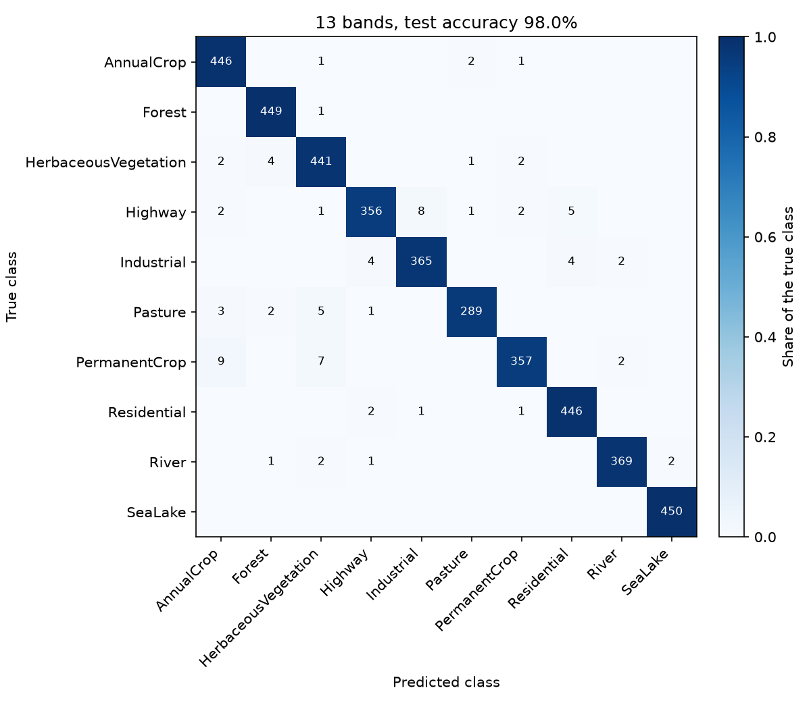
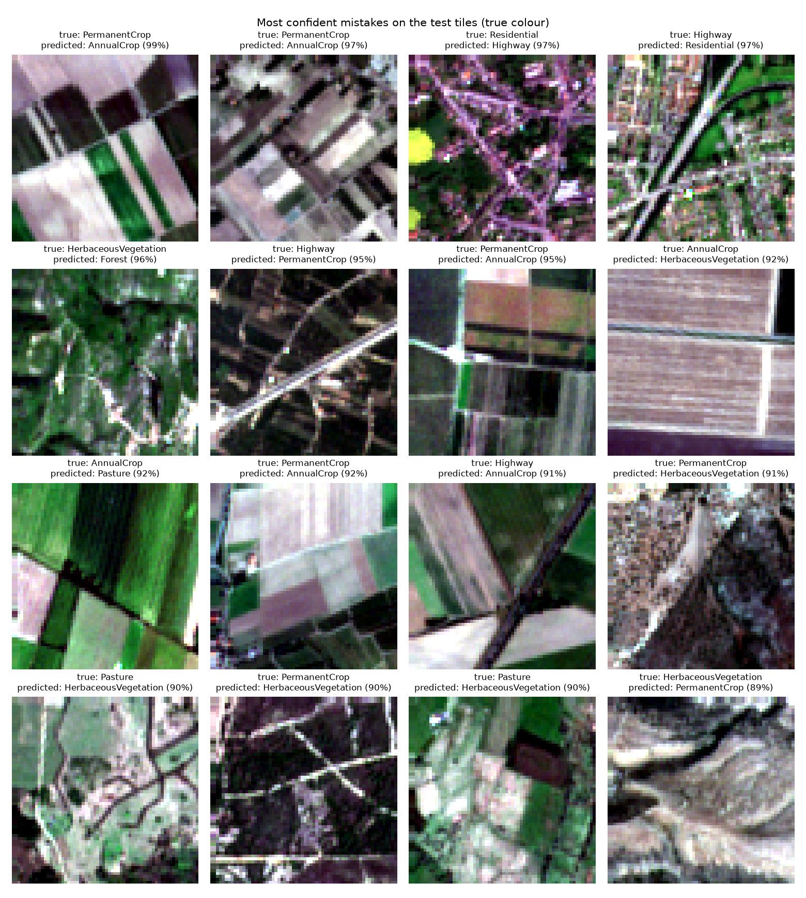
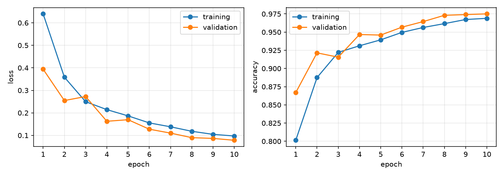

# Land-cover classification on EuroSAT with all 13 Sentinel-2 bands

A small convolutional neural network in PyTorch that classifies 64 × 64 px Sentinel-2 tiles into 10 land-cover classes using all 13 spectral bands. The same network trained on red, green and blue only serves as a comparison. The focus is on where the model fails: which classes it mixes up, how confident its mistakes are, and what the extra bands change.

## Data

[EuroSAT](https://zenodo.org/records/7711810) (Helber et al., 2019): 27,000 georeferenced Sentinel-2 tiles of 64 × 64 px in 10 classes: AnnualCrop, Forest, HerbaceousVegetation, Highway, Industrial, Pasture, PermanentCrop, Residential, River and SeaLake. This project uses the multispectral version (EuroSAT_MS, GeoTIFF, 13 bands, MIT license). `download_data.sh` downloads it (2.1 GB), checks the MD5 checksum and unpacks it into `data/`.

## Method

- **Split:** 70 % training, 15 % validation, 15 % test, stratified by class with a fixed seed. No tile appears in two splits; a test checks this.
- **Normalisation:** per-band mean and standard deviation, computed from the training tiles only.
- **Model:** three convolution blocks (64 → 32 → 16 → 8 px), global average pooling and a linear classifier, about 290,000 parameters. Networks pretrained on ImageNet expect three RGB channels, so this one is trained from scratch and its first layer takes all 13 bands directly.
- **Training:** AdamW (learning rate 0.001, weight decay 0.0001), cosine learning-rate schedule, 10 epochs, batch size 64. Tiles are randomly rotated by multiples of 90° and flipped, since images taken from above have no fixed "up". The epoch with the best validation accuracy is kept.
- **Evaluation:** accuracy on the test tiles, precision, recall and F1 per class, a confusion matrix, the most confident mistakes, and a closer look at the Forest class.

## How to run

Tested on Ubuntu under WSL 2. On a laptop CPU, one training run takes roughly 15 to 40 minutes. Keep the project in the Linux home folder rather than under `/mnt/c`, where reading 27,000 small files is much slower.
The trained models and data splits from these runs are in `runs/`, so after `bash download_data.sh`, `python evaluate.py --bands all` reproduces the results below without training.

```bash
sudo apt update && sudo apt install -y python3-venv python3-pip unzip
python3 -m venv .venv
source .venv/bin/activate
pip install torch --index-url https://download.pytorch.org/whl/cpu
pip install -r requirements.txt

pytest                          # 14 tests, about 30 seconds
bash download_data.sh           # 2.1 GB

python train.py --bands all     # all 13 bands
python evaluate.py --bands all
python train.py --bands rgb     # RGB only, for comparison
python evaluate.py --bands rgb  # also writes runs/comparison.md
```

Each run writes to `runs/all/` or `runs/rgb/`: `results.md`, `metrics.json`, `confusion_matrix.png`, `mistakes.png` and `training_curves.png`. With an NVIDIA GPU and the CUDA build of PyTorch, the scripts use the GPU automatically.

## Tests

`pytest` runs 14 tests on a tiny generated dataset, so they don't need the real data:

- **Split:** no tile lands in two splits, none is lost, every class is split with the same fractions, and the same seed gives the same split.
- **Data:** classes come from the folder names, tiles come out as 13-band (or 3-band) tensors with mean 0 and standard deviation 1 per band, and augmentation only moves pixels.
- **Model and training:** one score per class for 3 and 13 bands, the model can memorise a single batch, and one epoch returns a valid loss and accuracy.
- **Evaluation:** confusion matrix, precision, recall and F1 match values worked out by hand.

## Results

Accuracy on the 4,050 test tiles, which were never used for training or for choosing the best epoch. One training run per setting, on a laptop CPU (about 30 minutes each).

| Input | Test accuracy |
|---|---|
| RGB (3 bands) | 96.2 % |
| All 13 bands | 98.0 % |

F1 score per class:

| Class | RGB | 13 bands | Difference |
|---|---|---|---|
| AnnualCrop | 0.945 | 0.978 | +0.033 |
| Forest | 0.990 | 0.991 | +0.001 |
| HerbaceousVegetation | 0.937 | 0.971 | +0.035 |
| Highway | 0.969 | 0.963 | −0.005 |
| Industrial | 0.976 | 0.975 | −0.001 |
| Pasture | 0.953 | 0.975 | +0.022 |
| PermanentCrop | 0.925 | 0.967 | +0.043 |
| Residential | 0.990 | 0.986 | −0.004 |
| River | 0.935 | 0.987 | +0.052 |
| SeaLake | 0.990 | 0.998 | +0.008 |







Training accuracy stays slightly below validation accuracy because it is measured while augmentation and dropout are active.

## Where the model fails

- **Vegetation classes are the weak spot.** With 13 bands, PermanentCrop has the lowest recall (95.2 %): 9 test tiles go to AnnualCrop and 7 to HerbaceousVegetation. Orchards, vineyards, fields and grassland are all green vegetation, and in a single image at 10 m they can look alike. What separates permanent from annual crops is mainly time, since annual crops are sown and harvested within a season. One image can't show that; a time series could. Several of the most confident permanent-crop mistakes look like ordinary arable fields with bare soil to the eye as well, so some of these tiles may be ambiguous or mislabelled rather than misread.
- **Highways are judged by their surroundings.** Highway recall is 94.9 %, and the misses go to Industrial (8) and Residential (5). At 10 m a road is only one or two pixels wide, so most of a highway tile is whatever lies next to the road. In the mistakes figure, a thin road across fields becomes AnnualCrop and a motorway junction in a town becomes Residential.
- **The extra bands help where colour is not enough.** Going from 3 to 13 bands raises accuracy from 96.2 % to 98.0 %. The largest gains are for River, PermanentCrop, HerbaceousVegetation and AnnualCrop. Water absorbs near- and shortwave-infrared light strongly, and vegetation types differ more clearly in the red-edge and infrared bands than in visible colour. With RGB, 10 river tiles were taken for annual crops; with 13 bands, that mistake drops out of the most frequent ones. The built-up classes gain nothing: they are recognised by shape and layout, which RGB already shows.
- **Forest is reliable, but its few errors are the ones that matter for deforestation monitoring.** 99.8 % of forest tiles are found. One was called HerbaceousVegetation, and 7 non-forest tiles were called forest (4 HerbaceousVegetation, 2 Pasture, 1 River). Confusing forest with other green vegetation is exactly the error that would hide a clearing or raise a false alarm. The forest false alarm in the mistakes figure is dense, dark herbaceous vegetation that looks forest-like in true colour too.
- **The model can be confidently wrong.** Its most confident mistakes score up to 99 %, and 15 of its 82 mistakes on the test tiles score about 90 % or more. A high score alone would not flag them for a human check.

Differences of less than about one F1 point come from a single run per setting and may be noise.

## Next steps

- **Spatial split.** The split is random, so neighbouring tiles from the same area can end up in training and test, which likely makes the test accuracy optimistic. The tiles are georeferenced, so holding out whole areas would give a more honest estimate.
- **Several seeds per setting**, to see which of the small differences are real.
- **Longer training.** Validation accuracy was still rising at epoch 10.
- **Calibrated scores**, for example temperature scaling on the validation tiles, so that a high score really means a likely correct answer.
- **Image time series** to separate permanent from annual crops.
- Pretrained multispectral weights, for example from self-supervised models trained on Sentinel-2.

## Credits

Data: P. Helber, B. Bischke, A. Dengel, D. Borth (2019). EuroSAT: A Novel Dataset and Deep Learning Benchmark for Land Use and Land Cover Classification. *IEEE Journal of Selected Topics in Applied Earth Observations and Remote Sensing* 12(7), 2217–2226. Dataset DOI: [10.5281/zenodo.7711810](https://doi.org/10.5281/zenodo.7711810), MIT license.
